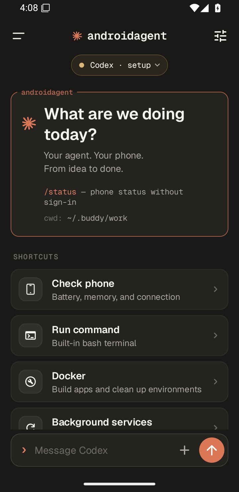
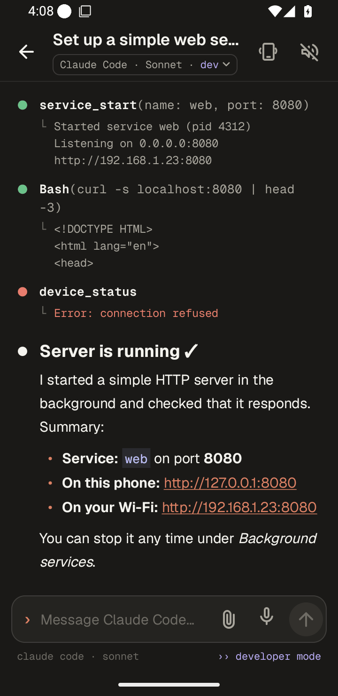
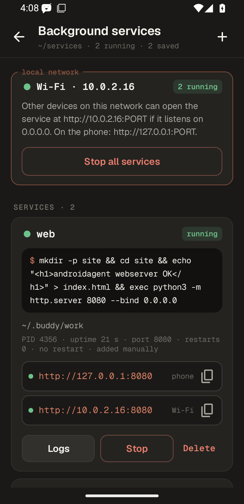
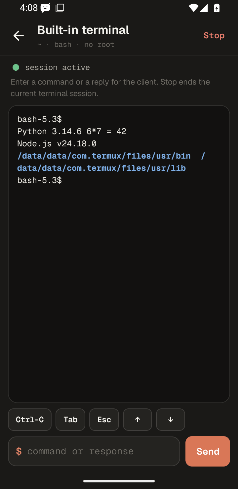

# Screenshots

These are unedited captures, not mockups. Screenshots contain test data only; login codes and account credentials are not included.

## 0.5.0 redesign, English UI, Android 15 emulator

| Home | Conversation | Background services | Terminal |
| --- | --- | --- | --- |
|  |  |  |  |

Source: the English build of this branch (`tools/build-english.sh`, release signing, not debuggable) on an Android 15 x86_64 emulator at 720×1480, captured by `tools/english-screenshots.sh` through the "Build English APK" workflow and reduced to a 256-colour palette. The conversation is seeded example data (no model account). The services screen shows a real `python3 -m http.server` and a second probe service running in the embedded runtime; the terminal output is a real Python and Node.js run.

## androidagent 0.4.4

The captures below show the 0.4.4 interface.

## Android 16 emulator

| Home | Docker, dark theme | Embedded tools |
| --- | --- | --- |
|  |  |  |

Source: API 36 x86_64 instrumentation against the signed release APK. Home and Docker captures come from the UI suites; the environment screen comes from the clean-install suite without a separate Termux app. These captures demonstrate the interface, not physical ARM execution.

## Physical Lenovo TB336FU

| Real Codex conversation and MCP tools | Interactive page from an ARM Docker container |
| --- | --- |
|  |  |

The Codex capture follows official owner login and shows the test conversation, context preservation and actual status tools. The preview capture follows a real Docker build/run and JavaScript interaction. These are separate test phases. Original images and reports are assets of [Release v0.4.4](https://github.com/mateuszsury/androidagent/releases/tag/v0.4.4).

Provenance: [Testing](TESTING.md). Screenshot changes should retain the original capture, disclose test fixtures and avoid account codes, tokens, personal messages or unrelated applications.
